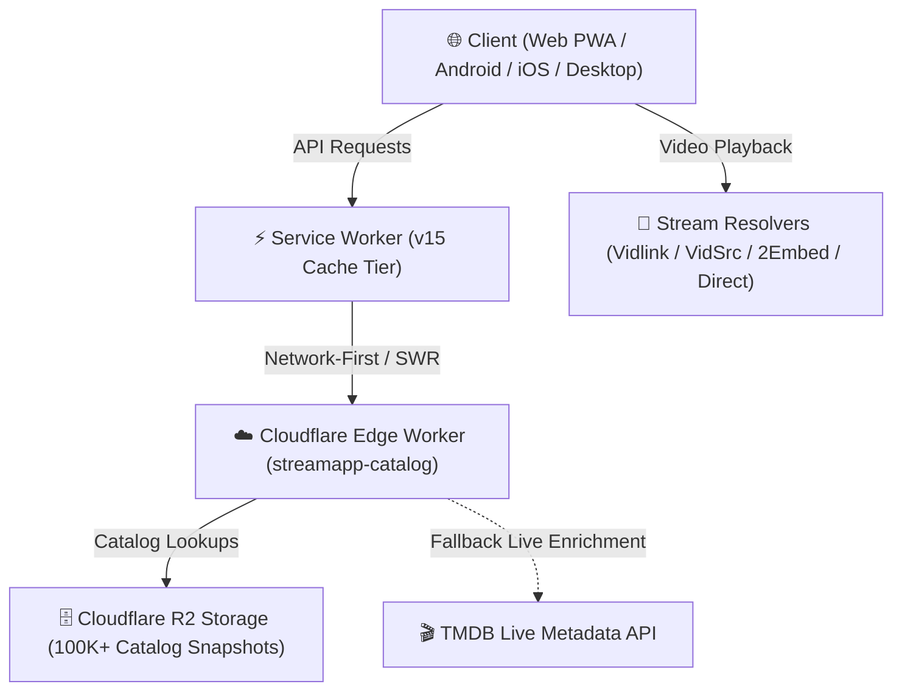

# 🎬 ShadowStream

<p align="center">
  <strong>Stream The Universe Without Limits.</strong><br>
  The next-generation, edge-accelerated streaming platform featuring a 100K+ global title catalog across 42 nations, intelligent multi-source playback failover, multi-lingual audio dubs, seamless TV season & episode indexing, and native cross-platform performance.
</p>

<p align="center">
  <a href="https://github.com/muhdfaisalwork-gif/ShadowStream/actions/workflows/ci.yml"></a>
  <a href="https://github.com/muhdfaisalwork-gif/github-seo-agent"></a>
  <a href="https://workers.cloudflare.com/"></a>
  <a href="https://expo.dev/"></a>
  <a href="https://www.ssmoviestvs.site"></a>
  <a href="https://github.com/muhdfaisalwork-gif/ShadowStream/blob/main/LICENSE"></a>
</p>

---

## ✨ Features That Set ShadowStream Apart

### ⚡ Lightning-Fast Edge Architecture
* Powered by **Cloudflare Workers** with zero cold starts and sub-millisecond edge routing.
* Global catalog snapshots distributed across Cloudflare R2 bucket storage.
* High-concurrency client experience with built-in stale-while-revalidate and network-first Service Worker caching (`v15`).

### 🌍 42-Nation World Cinema & Television Hub
* Explore cinematic masterpieces and television releases from **42 nations** across **7 key continental regions**:
  * 🇵🇰 **South Asia** (Pakistan, India, Bangladesh)
  * 🌸 **East Asia** (South Korea, Japan, China, Taiwan, Hong Kong, Indonesia, Thailand, Malaysia, Philippines)
  * 🕌 **Middle East** (Turkey, Egypt, Saudi Arabia, UAE, Iran, Lebanon, Morocco, Iraq, Syria)
  * 🗽 **The Americas** (United States, Canada, Mexico, Brazil, Argentina, Colombia)
  * 🏰 **Europe** (United Kingdom, France, Germany, Spain, Italy, Sweden, Norway, Denmark, Netherlands, Poland, Russia)
  * 🦁 **Africa** (Nigeria, South Africa, Ghana, Kenya, Ivory Coast)
  * 🦘 **Oceania** (Australia)
* Interactive origin flags, country catalogs, and dynamic regional feeds.

### 📺 Complete TV Series, Anime & Short Dramas
* Full episodic hierarchy with interactive **Season chips** and **Episode cards**.
* Live TMDB backfill and smart episode offset normalization so episodes never show empty.
* Instant season switching with episode thumbnails, synopsis, runtimes, and release dates.

### 🎙️ Multi-Audio Dubbing & Subtitles
* Switch seamlessly between original audio and localized dubs (Hindi, English, Korean, Chinese, Japanese, Arabic, Spanish, French, and more).
* Downloadable standalone MP3 dubbed tracks for offline entertainment.

### 🛡️ Smart Multi-Source Failover Engine
* Never encounter a "video unavailable" error again.
* Automatic priority routing across top-tier streaming providers:
  1. **Vidlink Pro** (Ad-Free HD, SUB/DUB selector)
  2. **VidSrc HD** (High-speed multi-quality streams)
  3. **2Embed** (Global multi-server fallback)
  4. **Direct Playback Streams** (Native MP4/HLS)

### 📱 Truly Cross-Platform
* **Web & PWA**: Responsive on all modern browsers (Desktop, Tablet, Mobile) with PWA install support.
* **Android**: High-performance native build with hardware-accelerated playback.
* **Desktop Ready**: Windows, macOS, and Linux compatibility.
* **External Player & Downloader Support**: Copy clean stream links directly into VLC, 1DM, ADM, or IDM for ultra-fast multi-threaded downloading.

---

## 🏗️ Architecture Overview



---

## 📊 Comparison Matrix: ShadowStream vs. Paid Subscriptions vs. Legacy Web Scrapers

| Feature / Metric | **🎬 ShadowStream** | **📺 Legacy Aggregators** | **💳 Fragmented Paid SaaS** |
| :--- | :---: | :---: | :---: |
| **Monthly Cost** | **$0 / month (Free & Open Source)** | $0 (Ad-supported) | $15 – $25/mo per provider |
| **Catalog Scope** | **100K+ Movies & TV (42 Nations)** | Limited & fragmented | Siloed catalog exclusivity |
| **Edge-Accelerated Speed** | **✓ Cloudflare R2 + Edge Workers** | ❌ Slow Origin Apache / PHP | ✓ Fast CDN |
| **Multi-Source Failover** | **✓ 4-Tier Automated Cascade** | ❌ Broken stream errors | ❌ N/A |
| **TV Seasons & Episodes** | **✓ Full Interactive Indexing** | ⚠️ Incomplete / out of order | ✓ Good |
| **Multi-Audio Dubs & MP3s** | **✓ Yes (Hindi, Japanese, etc.)** | ❌ Rare / missing | ⚠️ Platform dependent |
| **Zero Popup / Redirect Ads** | **✓ Clean Edge Delivery** | ❌ Malicious redirects & popups | ⚠️ Ads even on basic tiers |
| **Cross-Platform Portability** | **✓ Web PWA, Android, Desktop, VLC**| ❌ Browser only | ❌ DRM walled gardens |

---

## 🚀 Getting Started

### Prerequisites
* **Node.js**: `v20.x` or later
* **npm** or **yarn**
* **Cloudflare Wrangler CLI**: `npm install -g wrangler` (for worker deployment)
* **Python**: `3.10+` (optional, for catalogue ingestion/scraper scripts)

---

### 1. Clone the Repository
```bash
git clone https://github.com/muhdfaisalwork-gif/ShadowStream.git
cd ShadowStream
```

---

### 2. Run the Frontend (Web & Mobile)
```bash
cd frontend
npm install
npm run web
```
The app will launch locally at `http://localhost:8081`.

---

### 3. Run the Catalog Worker Locally
```bash
cd downloads/streamapp-worker
npm install
npx wrangler dev
```

---

## 🌐 Production Deployment

### Deploy Edge Worker
```bash
cd downloads/streamapp-worker
npx wrangler deploy
```

### Build & Deploy Frontend (Web / PWA)
```bash
cd frontend
npx expo export -p web
npx wrangler deploy
```

---

## 📁 Repository Structure

```
ShadowStream/
├── frontend/                     # React Native / Expo Web frontend
│   ├── src/
│   │   ├── screens/              # TitleDetail, TV, Countries, Browse, Player, etc.
│   │   ├── components/           # MediaCard, Poster, Header, TabBar, etc.
│   │   └── utils/                # API helpers, deep linking, audio language maps
│   ├── public/                   # Static PWA assets, manifest, robots, sw.js
│   └── worker.js                 # Frontend static assets worker
├── downloads/
│   └── streamapp-worker/         # Cloudflare Worker edge catalog backend
│       └── src/
│           ├── index.ts          # Edge routing, filtering, search, and resolver
│           └── providers.ts      # Multi-source playback registry
├── backend/                      # Node.js backend services & admin tools
├── scraper/                      # Python catalog scraper & R2 batch export tools
├── LICENSE                       # MIT Open Source License
└── README.md                     # Documentation
```

---

## 🤝 Contributing

Contributions make the open-source community an amazing place to learn, inspire, and create. Any contributions you make are **greatly appreciated**.

1. **Fork the Project**
2. **Create your Feature Branch** (`git checkout -b feature/AmazingFeature`)
3. **Commit your Changes** (`git commit -m 'Add some AmazingFeature'`)
4. **Push to the Branch** (`git push origin feature/AmazingFeature`)
5. **Open a Pull Request**

---

## 📄 License

Distributed under the **MIT License**. See [`LICENSE`](./LICENSE) for more information.

---

<p align="center">
  Built with ❤️ for cinema and television lovers worldwide.
</p>
